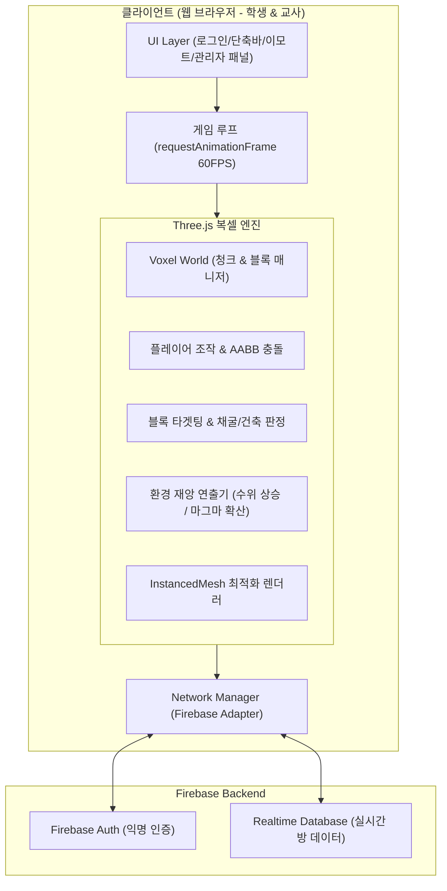

# 🛠️ 우리 마을 꾸미기 - 시스템 아키텍처 설계서 (ARCHITECTURE.md)

> 웹 기반 실시간 멀티플레이 3D 복셀 환경 교육 게임의 기술 스택, 렌더링 파이프라인, 네트워크 동기화 및 모듈 설계

---

## 1. 기술 스택 (Tech Stack)

| 레이어 | 기술 | 선정 이유 |
| :--- | :--- | :--- |
| **Frontend Framework** | **Vite + Vanilla TypeScript (또는 JS)** | 프레임워크 오버헤드 없이 초경량 고성능 번들링, 빠른 개발 서버 |
| **3D Rendering** | **Three.js** | 웹 표준 WebGL 렌더러, 광범위한 복셀/카메라 제어 생태계 |
| **물리 & 충돌 판정** | **경량 커스텀 AABB (축 정렬 바운딩 박스)** | 고사양 물리 엔진(Cannon, Ammo 등) 대신 학교 PC용 초경량 박스 충돌 엔진 |
| **Backend & Realtime** | **Firebase Realtime Database** | 웹소켓 기반 초저지연 상태 동기화, 서버 호스팅 없는 서버리스 아키텍처 |
| **인증 (Auth)** | **Firebase Anonymous Auth / Custom Nickname** | 학생 개인정보 수집 없는 익명/세션 기반 간편 로그인 |
| **호스팅 (Deploy)** | **Firebase Hosting / Vercel** | 단일 URL 배포로 크롬 브라우저에서 즉시 접속 |

---

## 2. 시스템 구성도 (System Architecture)



---

## 3. 핵심 기술 해결 과제 & 최적화 전략

### (1) 학교 PC / 크롬북 저사양 환경 최적화 (Rendering Optimization)
마인크래프트 류 게임은 블록이 수만 개로 늘어나면 **드로우 콜(Draw Call)** 병목으로 프레임 드랍이 발생하기 쉽습니다.
- **`THREE.InstancedMesh` 도입**:
  - 동일한 블록 텍스처(잔디, 흙, 나무 등)끼리 인스턴싱하여 **수만 개의 블록을 단 1~2회의 드로우 콜**로 렌더링.
- **보이지 않는 면 숨기기 (Hidden Face Removal)**:
  - 6개 면 중 다른 블록에 완전히 가려진 면은 지오메트리 생성에서 제외하여 렌더링 버텍스 80% 이상 절감.
- **청크(Chunk) 기반 관리**:
  - 16×16×32 블록 단위로 월드를 분할하여, 변경된 청크만 메시를 재계산.

### (2) 네트워크 동기화 최적화 (Firebase RTDB Bandwidth & Latency)
동시 접속자 20~30명이 블록을 설치하고 이동할 때 트래픽과 지연시간을 최소화합니다.
- **초기 월드 절차적 생성 (Procedural Seed)**:
  - 기본 지형(숲, 언덕, 강, 바다)은 **서버에서 모든 블록 데이터를 보내지 않고**, **방 생성 시 정해진 단 하나의 시드(Seed)**로 각 클라이언트가 로컬에서 동일하게 생성.
  - 네트워크 전송량 99% 절약.
- **블록 델타 동기화 (Delta Updates)**:
  - 플레이어가 블록을 부수거나 설치했을 때만 해당 좌표의 변경점(`{ x, y, z, blockType }`)만 실시간 전송.
- **플레이어 위치 보간 (Interpolation & Throttling)**:
  - 위치 전송은 초당 10회(100ms 단위)로 제한(Throttling)하고, 수신 측에서는 선형 보간(Lerp)으로 부드럽게 렌더링.

### (3) 사유지(Plot) 건축 권한 판정 로직
```typescript
function canBuildAt(x: number, y: number, z: number, playerPlot: PlotBounds): boolean {
  // 1. 자신의 구역 경계 내부인지 검사
  const isInsidePlot = (
    x >= playerPlot.minX && x <= playerPlot.maxX &&
    z >= playerPlot.minZ && z <= playerPlot.maxZ
  );
  
  if (!isInsidePlot) {
    // UI에 "자신의 구역에만 건축할 수 있습니다!" 툴팁 표시
    return false;
  }
  return true;
}
```

### (4) 환경 재앙 및 전조 이벤트 엔진 (Eco-Disaster Engine)
전역 환경 지표의 변화에 따라 씬의 렌더링 상태를 동적으로 전환합니다.

- **[중간 힌트 1] 게릴라 폭우 & 일시적 발목 침수**:
  - **비 파티클**: `THREE.Points` 기반의 빗방울 파티클 시스템 활성화.
  - **수위 서보(Servo) 애니메이션**: `waterMesh.position.y`를 평소 높이(예: Y=0)에서 발목 높이(Y=0.8)까지 10초간 서서히 올렸다가, 1분 유지 후 원래 높이로 자연스럽게 하강(Lerp).
  - 플레이어 발소리를 물 첨벙 사운드로 전환하고 이동 속도 15% 감속.
- **[중간 힌트 2] 국소 마그마 분출 & 진입 차단**:
  - 굴착이 집중된 좌표를 중심으로 `3×3×2` 영역에 붉은 마그마 블록 생성.
  - **위험 지대 AABB 트리거**: 해당 영역 반경에 투명한 데미지/밀림 바운딩 박스를 두어, 플레이어가 접근 시 뒤로 튕겨 나가는 넉백(Knockback) 물리 적용.
- **최종 대재앙 (티핑 포인트)**:
  - **해수면 폭주**: `waterMesh.position.y`를 지상 1~2층 높이(Y=4~6)까지 영구적으로 상승.
  - **마그마 역류**: 지하 Y < 5 구역의 빈 공기 블록들을 재귀적으로 마그마 블록으로 치환.
  - **하늘 색 및 분위기 전이**: Three.js 배경색과 안개(Fog)를 맑은 하늘색(0x87CEEB)에서 주황/붉은색(0x3D1A10)으로 보간.

---

## 4. 프로젝트 폴더 구조 제안

```text
class-minecraft-game/
├── public/
│   ├── assets/
│   │   ├── textures/      # 잔디, 흙, 목재, 마그마, 물 등 블록 텍스처
│   │   ├── sounds/        # 블록 채굴음, 파도 소리, 경고 사이렌, 이모트 효과음
│   │   └── emotes/        # 3D 팝업 이모티콘 텍스처
├── src/
│   ├── core/
│   │   ├── Engine.ts      # Three.js 씬, 카메라, 렌더러 루프
│   │   ├── World.ts       # 청크 관리, 절차적 월드 생성
│   │   ├── VoxelMesh.ts   # InstancedMesh 및 지오메트리 빌더
│   │   └── Physics.ts     # AABB 바운딩 박스 플레이어 충돌
│   ├── game/
│   │   ├── Player.ts      # 1인칭 조작, 인벤토리, 핫바
│   │   ├── PlotManager.ts # 학생별 구역 배정 및 권한 판정
│   │   ├── EcoEngine.ts   # 전역 온난화/마그마 재앙 시뮬레이터
│   │   └── EmoteSystem.ts # 머리 위 3D 이모지 연출
│   ├── network/
│   │   ├── Firebase.ts    # Firebase 초기화 및 인스턴스
│   │   ├── RoomManager.ts # 반 코드 생성 및 참여
│   │   └── SyncAdapter.ts # 위치, 블록 델타, 환경 지표 실시간 동기화
│   ├── ui/
│   │   ├── LoginModal.ts  # 학생/교사 접속 창
│   │   ├── AdminPanel.ts  # 교사용 실시간 관제 대시보드
│   │   ├── HotbarUI.ts    # 블록 선택 단축바 UI
│   │   └── DebriefUI.ts   # 게임 종료 후 환경 통계 및 디브리핑 창
│   └── main.ts            # 진입점
├── index.html
├── package.json
└── tsconfig.json
```
