# 📋 [수업 지도안] 우리 마을 꾸미기 - 환경 교육 수업 계획서 (LESSON_PLAN.md)

> **"우리가 만든 멋진 도시, 왜 물에 잠겼을까?"**  
> 마인크래프트형 메타버스 게임을 활용한 **'공유지의 비극'과 기후 위기** 융합 수업

---

## 1. 수업 개요

| 항목 | 내용 |
| :--- | :--- |
| **교과 영역** | 환경 / 도덕 / 사회(지리·경제) / 정보 융합 |
| **대상 학년** | 초등학교 5~6학년 ~ 중학교 1~3학년 |
| **수업 차시** | 1차시 (40분 ~ 45분) 또는 2차시 블록타임 |
| **수업 모형** | 체험 기반 시뮬레이션 학습 + 디브리핑(Debriefing) 토론 모형 |
| **핵심 성취기준** | 1. 인간의 무분별한 자원 개발이 환경에 미치는 영향을 설명할 수 있다. 2. '공유지의 비극' 현상을 이해하고, 지속 가능한 발전의 필요성을 제시할 수 있다. |
| **준비물** | 1인 1기기 (학생용 PC 또는 크롬북, 마우스 필수), 교사용 메인 스크린/빔프로젝터 |

---

## 2. 수업 진행 단계 (40분 기준)

```mermaid
gantt
    title 40분 수업 타임라인
    dateFormat  mm
    axisFormat  %M분
    section 수업 단계
    [도입] 마을 축제 시작 & 룰 안내      :00, 05m
    [전개 1] 풍요로운 마을 개발 경쟁     :05, 18m
    [전개 2] 자연의 경고와 재앙 발발     :23, 07m
    [정리] 통계 공개 & 디브리핑 토론     :30, 10m
```

---

### [1단계: 도입 (0 ~ 5분)] "우리 반 멋진 마을 만들기 대회!"
- **교사 활동**:
  - *"여러분, 오늘 우리는 우리 반만의 멋진 메타버스 마을을 만들 거예요!"*
  - 칠판에 **방 코드(Room Code)**를 적고 학생 접속 안내.
  - 규칙 안내:
    - *"로그인하면 여러분 이름이 적힌 개인 땅이 주어집니다."*
    - *"내 땅을 마을에서 가장 멋진 집으로 꾸며보세요!"*
    - *"자원은 마을 밖 숲이나 땅에서 얼마든지 자유롭게 캐올 수 있습니다."*
- **학생 활동**:
  - 브라우저 접속, 반 코드 입력 후 자신의 구역(Plot) 확인 및 주변 탐색.
- **교사 팁**:
  - ⚠️ **환경에 대한 언급은 절대 하지 않습니다.** 아이들이 완전히 몰입하여 자원을 아낌없이 파헤치도록 유도하는 것이 핵심입니다.

---

### [2단계: 전개 1 - 개발기와 힌트 이벤트 (5 ~ 22분)] "경쟁적인 채굴과 스쳐 지나간 경고들"
- **학생 활동**:
  - 외곽 숲의 나무를 마구 벌목하여 목재 블록 획득.
  - 흙을 깊게 파서 건물의 지하실을 파거나 성벽을 쌓음.
  - 친구들의 집을 둘러보며 하트(❤️), 박수(👏) 이모지를 보내고 더 높고 멋진 건물 짓기 경쟁.
- **[힌트 이벤트 1] 10~15분 차: 게릴라 폭우와 발목 침수**:
  - 갑자기 비가 쏟아지며 학생들의 집 바닥까지 물이 차오름.
  - 학생 반응: *"선생님, 비 와서 발목까지 잠겨요!"*
  - **교사 발문/대처**: *"어라? 소나기가 오나 보네요! 금방 지나갈 테니 걱정 말고 집을 마저 지어보세요~"* (일부러 대수롭지 않게 넘겨 방심 유도)
  - 1분 뒤 물이 빠지고 해가 뜨자 학생들은 안도하며 벌목을 재개함.
- **[힌트 이벤트 2] 18~20분 차: 깊은 구덩이 마그마 분출 & 구역 폐쇄**:
  - 학생들이 흙을 깊게 판 자리에서 마그마가 튀어나오고 접근 금지 구역이 됨.
  - 학생 반응: *"으악 여기 불타요! 못 들어가요!"*
  - **교사 발문/대처**: *"땅을 너무 깊게 파서 지열이 올라왔나 봐요. 저긴 위험하니 다른 데 가서 흙을 파세요!"* ➔ 다른 숲/동산을 파헤치도록 자연스럽게 유도.

---

### [3단계: 전개 2 - 위기와 재앙 (22 ~ 30분)] "티핑 포인트와 대혼란"
- **상황 변화 (22분~25분 / 전조 심화)**:
  - 하늘이 점차 붉고 탁해지며, 해안선이 슬그머니 올라옴.
- **대재앙 발발 (25분~30분 / 재앙 단계)**:
  - 해수면이 폭주하여 1층 전체가 수몰.
  - 마을 곳곳의 구덩이에서 마그마가 일제히 역류.
  - 학생 반응: 자신이 지은 집이 망가져 패닉에 빠짐. 비명(😱), 눈물(😭) 이모지 폭발.

---

## 3. 핵심 디브리핑 질문 리스트 (토론 가이드)

| 단계 | 교사 질문 (발문) | 유도하고 싶은 학생의 생각/답변 |
| :--- | :--- | :--- |
| **1. 감정 환기** | *"마을이 물에 잠기고 마그마가 터졌을 때 어떤 기분이었나요?"* | *"제가 열심히 지은 집이 망가져서 너무 속상했어요."* |
| **2. 힌트 회고 (핵심!)** | *"게임 중간에 비가 와서 물이 발목까지 찼던 순간, 그리고 구덩이에서 마그마가 튀었던 순간 기억나나요? 그때 왜 멈추지 않았을까요?"* | *"그냥 지나가는 날씨인 줄 알았어요. 물이 금방 빠지길래 괜찮은 줄 알았어요. 마그마가 나와도 다른 데 파면 된다고 생각했어요."* |
| **3. 원인 추적** | *"그렇다면 그 일시적인 침수와 마그마는 무엇이 보낸 신호였을까요?"* | *"자연이 보낸 경고 신호였어요. 나무를 너무 많이 베고 땅을 너무 깊게 파서 지구온난화와 지반 붕괴가 시작되고 있었던 거예요."* |
| **4. 공유지의 비극** | *"왜 우리는 그 경고를 무시하고 숲과 땅을 끝까지 파헤쳤을까요?"* | *"내 집을 남들보다 더 멋지게 짓고 싶었고, 공용 숲은 누구의 것도 아니니까 먼저 다 쓰는 게 이득이라고 생각했어요."* |
| **5. 현실 연결 & 실천** | *"우리 현실의 기후 위기(폭우, 산불, 해수면 상승)도 혹시 지금 우리에게 보내는 '발목 침수' 같은 경고 아닐까요?"* | *"맞아요! 현실에서도 이미 폭염과 홍수로 경고가 오고 있어요. 지금 멈추고 재생 가능한 개발을 해야 해요."* |

---

## 4. 교사용 대시보드 조작 팁

1. **시간 단축 모드 (15분 속성 수업 시)**:
   - 교사 패널에서 `[환경 민감도: 높음(High)]`으로 설정하면, 나무 10그루만 베어도 해수면이 빠르게 차오릅니다.
2. **시연용 강제 발동**:
   - 수업 종료 시간이 촉박할 때는 `[즉시 재앙 발동 (Trigger Disaster)]` 버튼을 눌러 언제든 즉각적인 연출을 실행할 수 있습니다.
3. **재도전 모드 (2차시 연계 시)**:
   - 1차시에서 파멸을 경험한 뒤, 2차시에서는 *"자연과 공존하는 지속 가능한 마을 만들기"*를 주제로 규칙을 정하고 재도전할 수 있습니다.
