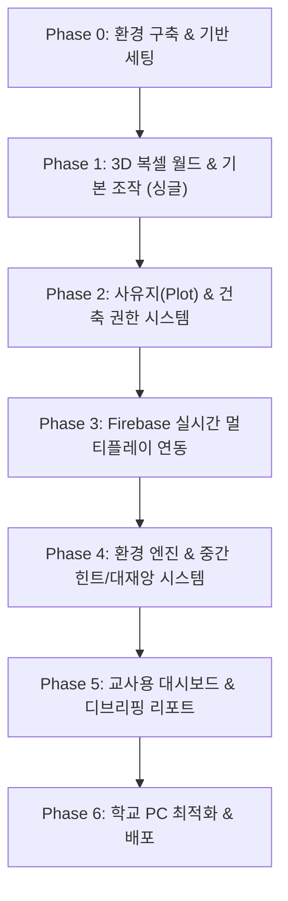

# 🗺️ 우리 마을 꾸미기 - 개발 로드맵 & 구현 태스크 목록 (ROADMAP.md)

> 단계별 마일스톤(Milestone)과 세부 태스크 체크리스트  
> 점진적으로 기능을 확장하며 매 단계 직접 플레이 테스트가 가능하도록 구성된 로드맵

---

## 📌 마일스톤 개요

---

## 🚀 Phase 0: 프로젝트 환경 구축 & 기반 세팅
- [ ] **프로젝트 초기화**
  - [ ] Vite + Vanilla TypeScript 기반 번들러 구성
  - [ ] Three.js 및 관련 라이브러리 의존성 설치
  - [ ] 기본 HTML 캔버스 및 반응형 창 크기 조절 리스너 설정
- [ ] **에셋 파이프라인 구성**
  - [ ] 복셀 텍스처 아틀라스 준비 (잔디, 흙, 참나무 원목, 나뭇잎, 돌, 모래, 물, 마그마)
  - [ ] 오픈소스 효과음 에셋 배치 (채굴음, 블록 설치음, 물소리, 빗소리, 이모트 알림음)

---

## 🌲 Phase 1: 3D 복셀 월드 & 기본 조작 (싱글플레이 검증)
> **목표**: 1인칭 시점으로 맵을 돌아다니며 블록을 부수고 설치하는 마인크래프트 기본 재미 구현

- [ ] **복셀 엔진 및 지형 렌더링**
  - [ ] 절차적 시드(Seed) 기반 지형 생성기 (중앙 평원, 외곽 숲/언덕, 해안선)
  - [ ] `THREE.InstancedMesh` 기반 드로우콜 최적화 렌더러 구현
  - [ ] 숨겨진 면(Hidden Face) 컬링 알고리즘 적용
- [ ] **플레이어 컨트롤러 & 물리**
  - [ ] Pointer Lock API 기반 1인칭 마우스 시점 회전
  - [ ] WASD 이동 및 Space 점프
  - [ ] AABB(축 정렬 바운딩 박스) 기반 블록 충돌 판정 및 중력 처리
- [ ] **블록 인터랙션 & 핫바 UI**
  - [ ] 카메라 시선 레이캐스팅(Raycasting) 기반 타겟 블록 하이라이트 박스
  - [ ] 좌클릭: 블록 파괴 (인벤토리 자원 수량 증가 + 채굴 파티클)
  - [ ] 우클릭: 선택된 블록 설치
  - [ ] 화면 하단 블록 선택 핫바(Hotbar, 숫자키 1~9 또는 마우스 휠) UI 연동

---

## 🏡 Phase 2: 사유지(Plot) & 건축 권한 시스템
> **목표**: 공유지의 비극을 유도하기 위한 "내 땅만 건축 가능 / 공용지는 자유 채취" 규칙 구현

- [ ] **대지(Plot) 그리드 생성**
  - [ ] 마을 중앙 광장을 중심으로 바둑판 형태(예: 12×12 블록)의 대지 구획 렌더링
  - [ ] 각 대지 경계선(울타리 또는 바닥 가이드라인) 표시
  - [ ] 대지 입구 명패(3D 텍스트 또는 캔버스 스프라이트 푯말) 렌더링
- [ ] **건축/채굴 권한 분리 로직**
  - [ ] 내 구역 내부: 블록 설치(건축) 및 파괴 모두 허용
  - [ ] 내 구역 외부: **블록 설치 절대 불가** (시도 시 "자신의 구역에만 건축할 수 있습니다!" 안내 팝업)
  - [ ] 공용 구역(숲/대지): **블록 채굴(벌목/굴착)은 어디서나 100% 허용**

---

## 🌐 Phase 3: Firebase 실시간 멀티플레이 연동
> **목표**: 반 코드 기반 방 접속, 동시 접속자 위치 동기화, 초경량 블록 델타 공유, 이모지 소통

- [ ] **Firebase 프로젝트 설정 & Auth**
  - [ ] Firebase SDK 초기화 및 Realtime Database 연결
  - [ ] 반 코드(Room Code) + 학생 이름 + 비밀번호 기반 간편 세션 입장
- [ ] **실시간 위치 및 상태 동기화**
  - [ ] 다른 학생들의 3D 아바타(복셀 캐릭터 모델) 렌더링
  - [ ] 플레이어 위치 전송 Throttling(100ms) 및 선형 보간(Lerp)으로 부드러운 움직임 구현
  - [ ] 접속 종료 시 아바타 및 세션 정리
- [ ] **블록 델타 동기화 (World Deltas)**
  - [ ] 플레이어가 블록을 부수거나 설치할 때 해당 좌표 델타만 RTDB 전송
  - [ ] 다른 플레이어 화면에 실시간 블록 생성/제거 반영
- [ ] **3D 이모지(Emote) 시스템**
  - [ ] 화면 하단 이모트 버튼 UI (❤️, 😡, 👏, 😭, 🌲, 😱)
  - [ ] 클릭 시 플레이어 머리 위에 3D 말풍선 스프라이트 팝업 (2~3초 후 사라짐) 및 동기화

---

## 🌋 Phase 4: 환경 엔진 & 중간 힌트/대재앙 시스템
> **목표**: 벌목/굴착 누적치에 따른 중간 복선 이벤트 및 최후의 환경 대재앙 시뮬레이션

- [ ] **전역 환경 지수 집계기 (Global Eco Engine)**
  - [ ] RTDB 상의 학급 전체 벌목 수(`treesCut`) 및 굴착량(`dirtDug`) 트랜잭션 집계
- [ ] **중간 힌트 이벤트 구현**
  - [ ] **[힌트 1] 게릴라 폭우 & 발목 침수**:
    - [ ] 비 파티클(`THREE.Points`) 생성 및 사운드 재생
    - [ ] 수위(Y좌표) 발목 높이까지 상승 후 1분 뒤 자연 복귀
  - [ ] **[힌트 2] 국소 마그마 분출 & 진입 금지 구역**:
    - [ ] 굴착 깊은 좌표에 마그마 블록 배치 및 화산암화
    - [ ] 접근 시 플레이어 뒤로 튕겨 나가는 넉백(Knockback) 물리 적용
- [ ] **최후의 티핑 포인트 대재앙 구현**
  - [ ] 하늘 색 및 안개(Fog) 맑은 하늘 ➔ 붉은 주황빛 전이
  - [ ] 해수면 1~2층 높이까지 영구 상승 (마을 전체 수몰)
  - [ ] 지하 공동 구역 마그마 블록 동시 역류

---

## 👩‍🏫 Phase 5: 교사용 관제 대시보드 & 디브리핑 리포트
> **목표**: 선생님이 수업을 통제하고, 게임 종료 후 환경 교육 효과를 극대화하는 UI

- [ ] **교사용 관리자 패널 (Admin Panel)**
  - [ ] 반 코드 개설 및 관리자 비밀번호 로그인
  - [ ] 접속 학생 실시간 목록 및 Plot 배정 현황 확인
  - [ ] 전역 환경 지표(벌목 수, 굴착량, 해수면 높이) 실시간 게이지
  - [ ] 수업 제어 버튼: `[게임 시작]`, `[시간 2배속/5배속]`, `[즉시 재앙 발동]`, `[리셋]`
- [ ] **학생 디브리핑 결과 화면 (Debrief UI)**
  - [ ] 대재앙 발발 시 플레이 잠금 및 전체 조망 카메라 전환
  - [ ] 학급 통계 카드 출력 (베어낸 총 나무 수, 파헤친 흙의 양, 상승한 해수면)
  - [ ] 현실 지구온난화/공유지의 비극 연계 성찰 질문 팝업

---

## ⚡ Phase 6: 최적화, 수업 현장 검증 & 배포
- [ ] **학교 저사양 PC/크롬북 벤치마크**
  - [ ] 학생 20~30명 동시 접속 시 60 FPS 방어 검증
  - [ ] WebGL 메모리 누수 점검 및 텍스처 해상도 최적화
- [ ] **배포 (Deployment)**
  - [ ] Firebase Hosting 또는 Vercel을 통한 단일 링크 원클릭 접속 환경 구축
  - [ ] 실제 교실 수업 시뮬레이션 테스트
